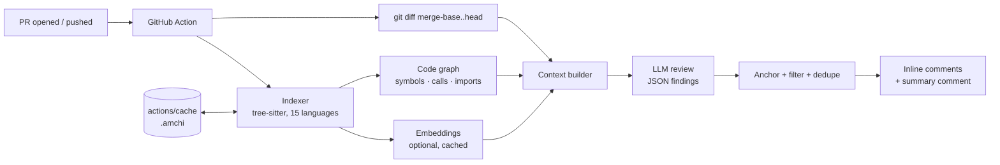

# Amchi

*Amchi* (ཨམ་ཆི) is Tibetan for "doctor": it checks your pull requests before they ship.

A self-hosted AI code reviewer that runs as a **GitHub Action** with **your own** OpenAI, Claude or Gemini key. You pay only for the tokens you use. There's no per-seat fee and no per-review overage.

It builds a **code graph** of the whole repository (functions, classes, imports, call edges) and uses it to give the model the context a senior reviewer would look at. That includes the full functions being changed, the real signatures of what they call, every caller that might break, related tests, and similar code elsewhere in the repo.

## What it does

- **Inline review comments** on bugs, logic errors, breaking changes, security and performance problems. Each one carries a colored **priority badge (P0–P4)**, a one-click ` ```suggestion ` fix when the fix is small and certain, and a collapsible **"Prompt To Fix With AI"** block you can paste into Claude Code, Cursor or Copilot.
- **PR summary comment** headed by a **Confidence Score (1–5)** and a risk label, followed by a numbered findings list that links to each inline comment, a **"Fix with agent prompt"** block covering every issue, a Mermaid sequence diagram and a per-file change table. It updates in place on every push.
- **Incremental reviews.** New pushes only review the commits since the last review, and comments are never posted twice. A run that runs out of time or tokens still posts what it found, and the next run starts with the files it missed.
- **Impact analysis from the graph:** callers of changed functions, removed functions that are still referenced, and deleted files that are still imported. The last check is deterministic, with no LLM involved.
- **Chat.** Comment `@amchi how is the session token validated?` on any PR or issue, or inside an inline thread, and it answers using the code graph with links to the code.
- **Re-run on demand** with `@amchi review`.
- **Team rules and instructions** per path glob, in `.codereview.yml`.
- **Cost guards:** a per-run token budget and time budget, max files, max comments, skipping drafts, bots and labels, and token usage printed in every summary.
- **Any provider:** Anthropic, OpenAI, Gemini, or any OpenAI-compatible endpoint (OpenRouter, Azure, DeepSeek, Groq, vLLM, Ollama).

## How it works



1. **Index.** It parses every source file with tree-sitter (WASM, no native build) into symbols, call edges and resolved imports. The index is cached in `.amchi/` through `actions/cache`, so later runs only re-parse changed files. Embeddings, if enabled, are cached by content hash and only computed for new code.
2. **Retrieve.** For each changed file it gathers the enclosing functions after the change, the definitions of functions the new code calls, callers of the changed functions, references to removed functions, importers and related tests, plus a hybrid (BM25 + embedding) search for similar code. Everything is packed into a token budget by priority.
3. **Review.** Files that depend on each other (imports, callers of changed functions) are sent in the same call so a signature change is reviewed next to its updated callers; small files share calls and large files go alone. The model returns structured JSON. Every finding is checked against the real diff lines GitHub will accept, deduplicated, filtered by severity and confidence, and capped.
4. **Post.** Findings go out as one review with inline comments, and the summary comment is created or updated. Each comment carries a hidden fingerprint so re-runs never duplicate it.

Supported languages (full graph): TypeScript, TSX, JavaScript, Python, Go, Rust, Java, Kotlin, Dart/Flutter, C, C++, C#, PHP, Swift, Scala, Lua. Other text files (Ruby, SQL, YAML, Markdown, Vue, etc.) are still reviewed and searchable without the call graph.

For Dart, `package:<name>/…` imports resolve through the `name:` in `pubspec.yaml` (and `packages/<name>/lib/…` in monorepos), so callers across your Flutter app are part of the review context.

## Setup

**1. Publish the action.** Push this folder to a repo in your org, for example `your-org/amchi`, and tag it:

```bash
git init && git add -A && git commit -m "Amchi v2"
git remote add origin git@github.com:your-org/amchi.git
git push -u origin main
git tag v2 && git push origin v2
```

`dist/` is committed on purpose because GitHub runs the action from it. If the action repo is private, allow access in its *Settings → Actions → General → Access* so your other repos can use it.

**2. Add an API key secret** to the repo (or org) being reviewed: `ANTHROPIC_API_KEY`, `OPENAI_API_KEY` or `GEMINI_API_KEY`. One is enough. Reviewing with OpenAI or Gemini also turns on semantic search with that same vendor's embeddings; with Claude, set `embeddings: openai` or `gemini` if you want to send code chunks to a second vendor for it.

**3. Add the workflow.** Copy [`examples/workflow.yml`](examples/workflow.yml) to `.github/workflows/code-review.yml` and point its `uses:` line at the action repo and tag you published. Optionally copy [`examples/.codereview.yml`](examples/.codereview.yml) to the repo root.

That's it. Open a PR.

> **Fork PRs:** GitHub doesn't give secrets to `pull_request` runs from forks, so those PRs are skipped with a notice. For private company repos this doesn't matter.

## Configuration

Everything lives in `.codereview.yml`; see [the annotated example](examples/.codereview.yml). Action inputs (`model`, `min_severity`, `max_comments`, `verify`, `fail_on`, …) override the file. The most useful settings:

| Setting | Default | What it does |
| --- | --- | --- |
| `provider` / `model` | auto / per provider | `claude-sonnet-5-5`, `gpt-5.5`, `gemini-3.8-flash` by default. A cheaper model cuts cost a lot. |
| `rules` | `[]` | Natural-language team rules, optionally scoped by `paths`. |
| `instructions` | – | Extra guidance added to every prompt. |
| `review.min_severity` | `low` | Raise to `medium` for fewer, higher-signal comments. |
| `review.max_comments` | `15` | Cap on inline comments per run. |
| `review.verify` | `false` | Second pass that removes false positives (about 2x tokens). `verify_model` runs it on a cheaper model. |
| `review.incremental` | `true` | Only review new commits on later pushes. |
| `review.fail_on` | `none` | Fail the check (to block merging) on e.g. `high`. |
| `review.badges` | `image` | `text` swaps the colored P0–P4 badge images for plain `[P1]` labels (for runners without internet access). |
| `limits.max_total_input_tokens` | `1,500,000` | Hard stop per run. Protects against giant PRs. |
| `limits.max_run_seconds` | `900` | Wall-clock budget for the run, indexing included. Files not reviewed in time are skipped, the partial review is posted, and the next run reviews them first. Keep it under the job's `timeout-minutes`. |
| `embeddings` | `auto` | `auto` embeds only with the review provider's own API (OpenAI or Gemini), so code never goes to a second vendor unless you name one. `off` uses keyword + graph retrieval only. |

## Controlling cost

Every summary ends with the exact number of LLM calls and input/output tokens for that run, so you can compare with your provider's pricing. The job summary and log also print a findings funnel (raw → verified → anchored → passing → capped → posted) and per-stage timings, so you can see where findings are lost and where time goes. Typical patterns:

- A normal PR (5–10 files) is usually **1–3 review calls plus 1 summary call**, about 20–60k input tokens in total.
- Incremental pushes only send the new commits.
- Embeddings are paid once per code chunk and then cached, so after the first run only changed code is embedded.
- To spend less, use a smaller model (`model: gpt-5.4-mini` or a Flash model), set `embeddings: off`, raise `min_severity`, add `ignore` globs for generated code, or lower `limits.max_total_input_tokens`.

## Design decisions

Architecture decision records live in [`docs/adr/`](docs/adr/README.md). User-visible changes per release are in [`CHANGELOG.md`](CHANGELOG.md).

## Security

- **Config comes from the base branch.** On PRs, `.codereview.yml` is read from the PR's base commit, so a PR can't change its own rules or instructions. `base_url` is accepted only as an action input, and it is only ever used with the OpenAI key, so no PR or config can redirect your API keys.
- **No repo code is executed.** Files are parsed, never run or installed. Symlinks are skipped, so a committed link to `.git/config` or a runner file can't leak into a prompt.
- **Only the bot's own comments are trusted** for state and deduplication, and the bot never answers its own comments.
- **Chat is limited to trusted commenters** (`OWNER`, `MEMBER`, `COLLABORATOR` by default), so strangers on a public repo can't spend your tokens.
- **Prompt injection.** The model reads the PR's code, so a malicious PR could try to steer what the bot *writes in comments*. The bot can only comment; it has no tools and can't push, approve, or merge.

## Run it locally (no GitHub needed)

Works on Windows, macOS and Linux with Node 20+:

```bash
npm install && npm run build

# review your current branch against main
set ANTHROPIC_API_KEY=...            # PowerShell: $env:ANTHROPIC_API_KEY="..."
node dist/cli.js review --repo C:\code\my-app --base main

# ask questions about a codebase
node dist/cli.js ask "where do we validate JWTs?" --repo C:\code\my-app

# try the whole pipeline offline with the mock provider
node dist/cli.js review --repo C:\code\my-app --base main --provider mock
```

Set `AMCHI_DUMP_PROMPTS=./prompts` to write every prompt and response to a folder. This is useful when tuning rules or debugging a bad comment.

## Development

```bash
npm install
npm run typecheck
npm test          # parser, indexer, diff, end-to-end review (mock LLM), GitHub posting
npm run build     # bundles dist/index.js + dist/cli.js and copies the WASM grammars
```

`vitest.config.ts` runs test workers with `--liftoff-only`; without it the Swift grammar can crash a worker with a V8 out-of-memory error. Commit `dist/` together with any change under `src/`, since the action runs from it.

Project layout:

```
src/
  index.ts            GitHub Action entry (review / chat / index)
  cli.ts              Local CLI
  run.ts              Shared review pipeline
  config.ts           .codereview.yml schema + defaults
  graph/              tree-sitter parser, indexer, import resolver, hybrid search
  review/             context builder, prompts, reviewer, markdown rendering
  chat/               @amchi question answering
  llm/                OpenAI / Anthropic / Gemini clients, retries, budget tracking, mock
  github/             Octokit wrapper (reviews, sticky summary, threads, reactions)
  git/                git helpers + unified diff parser
```

## Limitations

- It's a CI job, not a hosted service. The first run on a large repo spends a little time indexing (and embedding, if enabled); after that the cache makes runs incremental.
- Call edges are name-based. They're fast and language-agnostic, but not type-resolved, so a very common method name like `get` can link to several definitions. The context builder prefers definitions from imported files and the same directory.
- It reviews what the model can see. Very large diffs are truncated per file, and files past `max_files`, the token budget or the time budget are listed as skipped in the summary, with the reason.
